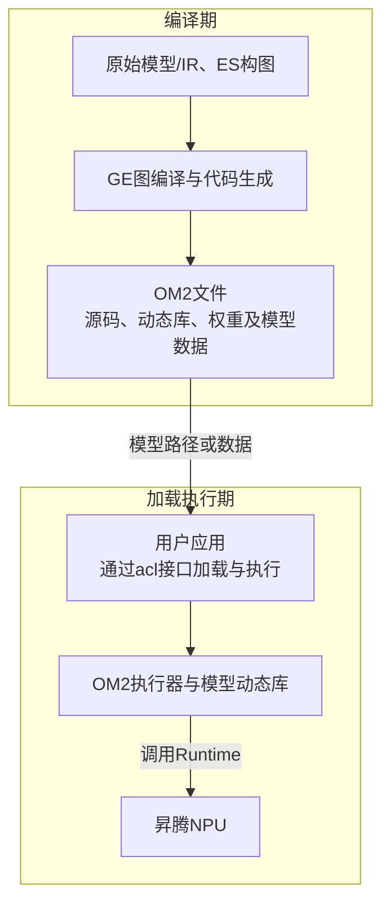
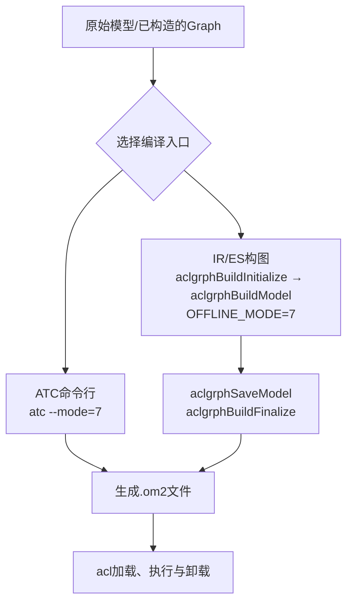
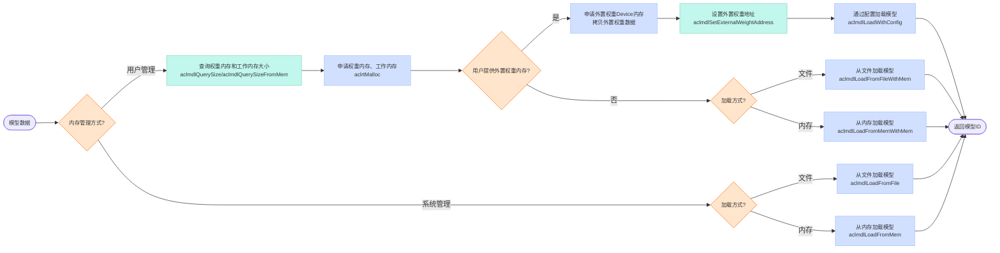
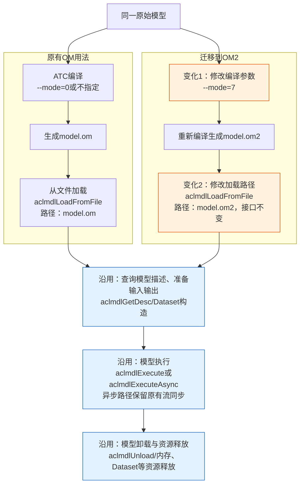

# OM2模型介绍

## OM2简介

OM2是GE以“模型即代码”方式交付编译结果的离线模型格式，文件后缀为`.om2`，定位为连接图编译与模型部署的透明执行载体。传统OM采用私有二进制格式保存模型信息，开发者通常需要借助专用工具分析其执行行为。加载时，模型结构反序列化、属性解压缩、算子Task定义解析三项操作的耗时占比接近30%，是影响模型启动速度的主要因素之一；相关处理还增加了GE执行时的体积，不利于边缘、端侧场景的快速启动与轻量化部署。为此，OM2在编译阶段生成模型专属的C++加载执行源码及动态库`lib<model_name>_om2.so`，并与模型元信息、常量权重、算子二进制及调试信息一同封装为可直接解压查看的ZIP文件，在提升模型可读性与可调试性的同时，减少加载阶段的上述处理开销。运行时，应用沿用acl Model接口，OM2执行器从内存中的归档数据解析`model_meta.json`、常量配置、算子二进制和模型动态库，通过`dlopen`/`dlsym`装载模型动态库并绑定其导出的C接口，完成模型加载、执行与资源释放；模型动态库在Host侧调用Runtime接口，驱动算子二进制在昇腾NPU上执行。整体关系如下图所示。



生成`.om2`文件完成的是模型编译。运行时，用户将模型文件路径传给`aclmdlLoadFromFile`，或将完整模型数据传给`aclmdlLoadFromMem`，加载成功后获得`modelId`；准备输入输出后，通过`aclmdlExecute`或`aclmdlExecuteAsync`发起推理，使用结束后调用`aclmdlUnload`。归档解析和模型动态库装载由acl内部的OM2执行路径完成，应用无需预先解压。具体调用流程见[加载与执行OM2模型](#加载与执行om2模型)。

### 主要特点

- **模型结构透明**：使用通用解压工具即可查看模型结构、执行源码、权重和算子二进制，让编译产物从“黑盒”变为可直接分析的模型包。
- **加载性能提升**：相比OM，模型加载性能提升80%。编译期生成模型专属的加载执行代码，省去加载阶段的Protobuf解析和图、Task等结构恢复开销。
- **可定位问题**：生成源码清晰呈现算子编排顺序、资源管理和地址使用逻辑，结合模型调试信息，帮助开发者定位精度与性能问题。
- **执行时依赖小**：仅保留模型调度所需的最小依赖，dump功能还可按需裁减，便于在资源受限的边缘、端侧环境中轻量化部署。
- **沿用acl接口**：沿用已有aclmdl加载、执行和卸载接口，常规迁移只需调整模型编译参数和加载路径，降低接入成本。

### 使用代价

- **引入交叉编译**：OM2包含在Host侧执行的模型动态库。当编译环境与部署环境的CPU架构不同时，需要准备目标架构的交叉编译工具链及依赖库，并配置编译命令。具体方法见[目标环境](#目标环境)。

### 与OM的区别

| 对比项 | OM | OM2 |
|--------|----|-----|
| 编译方式 | ATC默认生成`.om` | ATC指定`--mode=7`，或构图接口指定`OFFLINE_MODE=7` |
| 模型内容 | 私有二进制格式，通常通过专用工具查看 | ZIP格式，可直接查看模型信息、生成源码、动态库和算子二进制 |
| 加载方式 | 加载期恢复模型结构、解析任务定义 | 编译期生成加载执行代码，加载期装载模型动态库并初始化资源 |

## 用户界面

使用流程为：**编译生成`.om2` → 通过acl加载模型 → 准备输入输出 → 执行推理 → 卸载模型**。编译入口可选择ATC或IR/ES构图，加载执行流程相同。

### 准备环境

- 已安装支持OM2的CANN软件包并设置环境变量，方法见[环境准备](../../../quick_install.md#1-环境准备)。
- 准备可转换的原始模型（以下以ONNX为例）和推理输入数据。完整应用可参考[从OM迁移与样例体验](#从om迁移与样例体验)中的图片分类样例。
- **模型动态库的目标操作系统及CPU架构必须与执行器运行环境一致**。默认按编译环境生成，例如在Linux/x86_64环境原生编译的模型不能直接放到Linux/aarch64环境执行。交叉编译说明见[目标环境](#目标环境)。

### 转换离线OM2模型

下面给出两种编译入口的简易流程。选择其中一种生成模型，随后按[加载与执行OM2模型](#加载与执行om2模型)调用acl接口加载执行。



#### 通过ATC转换

通过`--mode=7`指定生成OM2。例如，将ONNX模型转换为OM2：

```bash
atc --mode=7 --model=./model/resnet50.onnx --framework=5 \
    --output=./model/resnet50_npu --soc_version=<soc_version>
```

将`<soc_version>`替换为实际昇腾AI处理器版本，模型路径按实际位置填写。命令成功后生成`./model/resnet50_npu.om2`，`--output`无需填写后缀。若原命令带有其他参数，需核对[ATC参数说明](../CLI_options/README.md)中各参数的OM2使用约束。

#### 通过IR/ES构图生成

通过IR/ES构图生成`ge::Graph`并初始化编译环境后，在传给`aclgrphBuildModel`的选项中设置`OFFLINE_MODE=7`。保存后得到`.om2`文件，按[加载与执行OM2模型](#加载与执行om2模型)加载执行：

```cpp
std::map<std::string, std::string> build_options = {
    {ge::ir_option::OFFLINE_MODE, "7"},
};
ge::ModelBufferData model;
auto ret = ge::aclgrphBuildModel(graph, build_options, model);
// 编译成功后保存，输出 ./model/resnet50_npu.om2。
ret = ge::aclgrphSaveModel("./model/resnet50_npu", model);
```

以上为已有程序中的修改片段，保留原有返回值检查和`aclgrphBuildFinalize`调用。接口说明见[aclgrphBuildModel](../../../api/graph_engine_api/cpp/ge/aclgrphBuildModel.md)和[aclgrphSaveModel](../../../api/graph_engine_api/cpp/ge/aclgrphSaveModel.md)。

上述编译流程最终交付`.om2`模型包，其中包含生成的模型源码、动态库、权重、算子二进制及元信息。应用可按[加载与执行OM2模型](#加载与执行om2模型)直接加载执行该模型包；编译产物的组成及其与原OM分区的关系见[编译期交付件：OM2模型包](#编译期交付件om2模型包)。

### 加载与执行OM2模型

用户可根据模型运行内存的管理方式，选择以下加载路径。加载成功后返回的`modelId`用于后续模型描述查询、推理执行和模型卸载。



通过aclmdl接口加载编译产物：

```cpp
const char *omModelPath = "./model/resnet50_npu.om2";
```

加载、执行、卸载的调用顺序如下。此处仅展示模型相关调用；完整应用还需完成acl初始化、Device/Context设置、Dataset准备、返回值检查和资源释放。

```cpp
uint32_t modelId;
aclError ret = aclmdlLoadFromFile(omModelPath, &modelId);
// 加载成功后，按模型描述准备inputDs和outputDs。
ret = aclmdlExecute(modelId, inputDs, outputDs);
ret = aclmdlUnload(modelId);
```

acl自动识别om和om2，无需在应用中增加格式判断，也无需先解压模型包。输入输出大小仍通过模型描述接口查询，不要复用旧模型的硬编码内存大小。

如果需要自行管理模型工作内存和权重内存，加载前先调用`aclmdlQuerySize`（文件）或`aclmdlQuerySizeFromMem`（内存）查询大小，申请Device内存后，分别通过`aclmdlLoadFromFileWithMem`或`aclmdlLoadFromMemWithMem`加载；也可使用`aclmdlSetConfigOpt`和`aclmdlLoadWithConfig`配置加载。这里的工作内存、权重内存与应用准备的输入输出缓冲区用途不同。

接口用法见[aclmdlLoadFromFile](../../../api/graph_engine_api/c/acl/aclmdlLoadFromFile.md)、[aclmdlLoadFromMem](../../../api/graph_engine_api/c/acl/aclmdlLoadFromMem.md)、[aclmdlExecute](../../../api/graph_engine_api/c/acl/aclmdlExecute.md)和[aclmdlExecuteAsync](../../../api/graph_engine_api/c/acl/aclmdlExecuteAsync.md)。

### 从OM迁移与样例体验

已有OM推理程序时，常规迁移只需两步：将ATC的`--mode=0`改为`--mode=7`（原来未指定时增加该参数），再将加载路径改为生成的`.om2`文件。初始化、输入输出Dataset构造、模型执行和资源释放流程沿用原有程序。**不能只将`.om`文件改名为`.om2`**。

以ATC编译、从文件加载模型为例，使用上的差异如下。橙色节点标出迁移时需要调整的两处，蓝色节点表示沿用原有调用流程；加载前的acl初始化及设备设置同样沿用原有程序。



使用额外编译参数或加载配置项时，先核对[ATC参数说明](../CLI_options/README.md)和[使用约束](#使用约束)。不同加载执行方式的迁移要点如下：

| 原有用法 | 切换到OM2时的处理 |
|----------|--------------------|
| 从文件加载`aclmdlLoadFromFile` | 修改模型文件路径 |
| 从内存加载`aclmdlLoadFromMem` | 读入完整`.om2`文件数据，传入数据地址和字节数 |
| 异步执行`aclmdlExecuteAsync` | 沿用原有流、执行与同步流程 |
| 配置加载`aclmdlLoadWithConfig` | 更新模型路径或内存数据，并核对[OM2支持的加载配置项](#加载配置项) |

可基于[ResNet-50图片分类样例](../../../../../examples/acl/1_sample_resnet50_imagenet_classification/README.md)体验OM2：

1. 按样例准备环境、模型和测试图片。
2. 在样例的模型转换命令中增加`--mode=7`，生成`model/resnet50.om2`。
3. 将`src/sample_resnet50_imagenet_classification.cpp`中`sampleRes50.PrepareModel("../model/resnet50.om")`的路径实参改为`"../model/resnet50.om2"`。
4. 按原样例完成图片预处理、编译和运行，检查`SAMPLE PASSED`及分类结果。

除模型转换参数和加载路径外，沿用样例的其他步骤。

## 编译期交付件：OM2模型包

[用户界面](#用户界面)介绍了如何生成和使用`.om2`文件。本节进一步介绍这一编译期交付件的内部结构，以及各部分与原OM分区的对应关系。

### 模型包结构介绍

模型包的目录结构及JSON字段说明见[om2模型内部结构](internal_structure_of_om2_model.md)。

### OM2目录结构与原OM分区对照关系

OM2将模型元信息、执行代码、算子二进制及权重分别组织为可查看的目录和文件。下表按职责与原OM分区进行对照，OM2路径采用当前实现中的命名，均相对包内根前缀。

| OM2文件或目录 | 原OM对应部分 | 说明 |
|----------------|----------------|------|
| `manifest.json` | OM Header（模型文件头） | 提供包级清单，记录版本兼容信息、模型数量和生成模型的ATC命令 |
| `data/model_N/model_meta.json` | `MODEL_INOUT_INFO` | 保存模型输入输出规格、工作内存大小、动态分档等元信息，供加载和模型描述查询使用 |
| `data/model_N/runtime/` | 无直接对应分区 | 保存生成的模型C++源码、构建文件和模型动态库，承载模型专属的加载、执行及资源管理逻辑 |
| `data/model_N/debug/ge_visual_00000000_graph_0.json` | `MODEL_DEF`（调试展示职责） | 保存图、算子、连接关系及属性等可视化信息，用于分析编译结果；普通模型加载不依赖该调试文件恢复图结构 |
| `data/kernels/` | `TBE_KERNELS` | 保存预编译的算子二进制，供模型加载时注册和执行时调用 |
| `data/constants/` | `WEIGHTS_DATA` | 保存内置常量与权重的二进制数据，由各模型的`constants_config.json`记录文件名、偏移和大小 |

该表是功能职责的对照，并非将OM二进制分区原样拆分为文件。例如，原OM的`TASK_INFO`由加载阶段解析，OM2则在编译阶段据此生成模型任务编排代码，随`runtime/`中的模型动态库交付。

## 使用约束

### 目标环境

通过ATC或IR/ES构图入口生成的OM2均包含在Host侧执行的模型动态库，**模型动态库的目标操作系统及CPU架构必须与执行器运行环境一致**。OM2文件可以跨平台解压查看，但包内动态库不能直接跨架构执行。
默认使用本机工具链生成模型动态库。例如，在Linux/x86_64环境原生编译得到的OM2，不能直接在Linux/aarch64环境运行；如果需要部署到Linux/aarch64，必须使用相应工具链交叉编译。

#### 编译环境与配置方式

编译环境需要可用的C++编译工具链和`make`。跨架构编译还需准备目标架构对应的依赖库。不同编译入口的配置方式如下。

**ATC入口**

使用`--host_env_os=linux --host_env_cpu=aarch64`指定交叉编译目标环境时，仅支持在x86_64主机上生成Linux/aarch64目标模型，不支持通过这组参数在aarch64主机上反向生成Linux/x86_64目标模型。命令示例如下：

```bash
atc --mode=7 --model=./model/resnet50.onnx --framework=5 \
    --output=./model/resnet50_npu --soc_version=<soc_version> \
    --host_env_os=linux --host_env_cpu=aarch64
```

将`<soc_version>`替换为目标昇腾处理器版本。`--host_env_cpu`也可设置为`arm64`。参数说明见[--host_env_os](../CLI_options/--host_env_os.md)、[--host_env_cpu](../CLI_options/--host_env_cpu.md)。

此外，可通过`--build_config`指定图编译阶段将生成源码编译为模型动态库时使用的make命令模板，用于自定义交叉编译器、编译选项、预处理选项和链接选项等参数。参数说明见[--build_config](../CLI_options/--build_config.md)。

**IR/ES构图入口**

IR/ES构图入口目前仅支持通过`OPTION_BUILD_CONFIG`配置模型动态库的编译命令，不支持`HOST_ENV_OS`、`HOST_ENV_CPU`。其用法与ATC的`--build_config`相同，通过make命令模板配置`CXX`、`CXXFLAGS`、`CPPFLAGS`、`LDFLAGS`和`LDLIBS`，无需指定Makefile路径。

以下片段展示如何指定aarch64交叉编译器：

```cpp
std::map<std::string, std::string> build_options = {
    {ge::ir_option::OFFLINE_MODE, "7"},
    {ge::ir_option::OPTION_BUILD_CONFIG, "make -s CXX=/usr/bin/aarch64-linux-gnu-g++"},
};

ge::ModelBufferData model;
auto ret = ge::aclgrphBuildModel(graph, build_options, model);
```

**设置`OPTION_BUILD_CONFIG`后，不会自动补充默认交叉编译器和目标库路径**。请按实际环境修改示例中的编译器路径，并配置目标架构的依赖库及编译、链接选项。模板格式及限制见[OPTION_BUILD_CONFIG](../../../api/graph_engine_api/cpp/ge/aclgrphBuildModel_config_params/operator_and_graph_compilation.md#option_build_config)。

### 编译参数

- 通过ATC生成OM2（`--mode=7`）时，各编译参数的使用约束见[ATC参数说明](../CLI_options/README.md)。
- 通过IR/ES构图入口生成OM2（`OFFLINE_MODE=7`）时，各构建选项的使用约束见[aclgrphBuildModel支持的配置参数](../../../api/graph_engine_api/cpp/ge/aclgrphBuildModel_config_params/aclgrphbuildmodel_config_params.md)。

### 加载配置项

加载配置项对OM2的支持情况见[aclmdlConfigAttr](../../../api/graph_engine_api/c/acl/aclmdlConfigAttr.md)，配置接口用法见[aclmdlSetConfigOpt](../../../api/graph_engine_api/c/acl/aclmdlSetConfigOpt.md)和[aclmdlLoadWithConfig](../../../api/graph_engine_api/c/acl/aclmdlLoadWithConfig.md)。加载时检查到配置了不支持的项，会返回`ACL_ERROR_INVALID_PARAM`。
